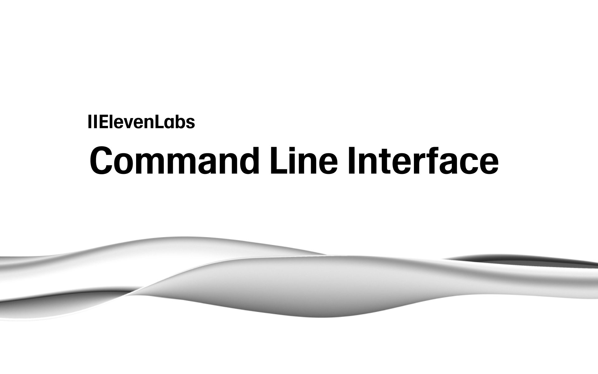
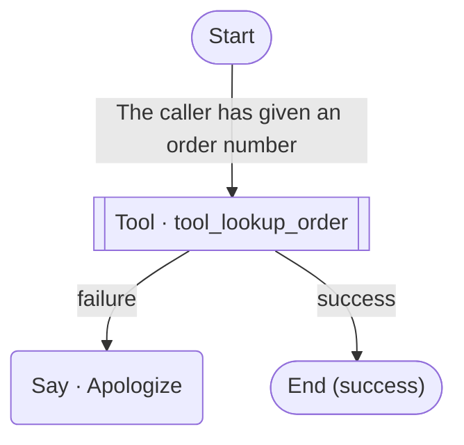

# ElevenLabs CLI — Agents as Code



Command-line interface for the [ElevenLabs platform](https://elevenlabs.io/docs/agents-platform/overview).

The CLI does two things:

- **Full API access** — every ElevenLabs API endpoint is available as a subcommand (`elevenlabs <resource> <method>`).
- **Agents as Code** — manage Conversational AI agents from local configuration files, with templates, branches, and push/pull sync.

## Table of contents

- [Installation](#installation)
- [Authentication](#authentication)
- [Quick start](#quick-start)
- [Speaking text](#speaking-text)
- [Waiting for Flows results](#waiting-for-flows-results)
- [Agents as Code](#agents-as-code)
- [Data residency](#data-residency)
- [UI components](#ui-components)
- [Usage](#usage)
- [Documentation](#documentation)
- [Advanced](#advanced)
  - [Common flags](#common-flags)
  - [Environment variables](#environment-variables)
  - [Telling us what you are doing](#telling-us-what-you-are-doing)
  - [Telemetry](#telemetry)
  - [Output formats](#output-formats)
  - [Shell completion](#shell-completion)
- [Development](#development)

## Installation

### Homebrew (macOS / Linux)

```bash
brew install elevenlabs/tap/elevenlabs
```

### Scoop (Windows)

```powershell
scoop bucket add elevenlabs https://github.com/elevenlabs/scoop-bucket
scoop install elevenlabs
```

### npm (macOS / Linux / Windows)

```bash
npm install -g @elevenlabs/cli
```

Installs the same binary through a thin launcher, picking the right build for
your platform. Use `npx @elevenlabs/cli <command>` to run it once without
installing it globally.

### Shell (macOS / Linux)

```bash
curl --proto '=https' --tlsv1.2 -LsSf https://github.com/elevenlabs/cli/releases/latest/download/elevenlabs-cli-installer.sh | sh
```

### PowerShell (Windows)

```powershell
powershell -ExecutionPolicy ByPass -c "irm https://github.com/elevenlabs/cli/releases/latest/download/elevenlabs-cli-installer.ps1 | iex"
```

### Build from source

Install the [Rust toolchain](https://rustup.rs/), then:

```bash
git clone https://github.com/elevenlabs/cli.git
cd cli
cargo build --release
```

The binary lands at `./target/release/elevenlabs`. To run it as `elevenlabs`
from anywhere, install it with cargo, which copies it into `~/.cargo/bin`:

```bash
cargo install --path .
```

## Authentication

Every request is authenticated with an [ElevenLabs API key](https://elevenlabs.io/app/settings/api-keys), sent as the `xi-api-key` header. Set it in the environment:

```bash
export ELEVENLABS_API_KEY=xi-...
```

A `.env` file in the working directory is loaded automatically, so putting `ELEVENLABS_API_KEY=xi-...` there works too — handy for keeping a key scoped to one project.

For a one-off call, pass it per command instead:

```bash
elevenlabs user get --xi-api-key xi-...
```

## Quick start

List available commands:

```bash
elevenlabs --help
```

Call an API endpoint:

```bash
elevenlabs <resource> <method>
```

Run `elevenlabs <resource> --help` to see available methods for a resource.

## Speaking text

Turn text into speech and play it, without picking a file path or finding a player:

```bash
elevenlabs say "this came from the terminal"
echo "build finished" | elevenlabs say          # or: elevenlabs say -
```

The voice, model, audio format and player default to whatever you have stored, and each can be overridden per run:

```bash
elevenlabs say config                                    # show the current defaults
elevenlabs say config voice 21m00Tcm4TlvDq8ikWAM
elevenlabs say config model eleven_multilingual_v2
elevenlabs say config player mpv
elevenlabs say config voice --unset                      # back to the built-in default

elevenlabs say "one off" --voice JBFqnCBsd6RMkjVDRZzb --model eleven_flash_v2_5   # faster, no audio tags
elevenlabs say "save it" --output out.mp3                # write a file, skip playback
```

Defaults are stored in `~/.elevenlabs/config.json` alongside [data residency](#data-residency). Out of the box `say` uses `eleven_v4` — the most expressive model, and (with v3) the only family that reads [audio tags](https://elevenlabs.io/docs/overview/capabilities/text-to-speech/best-practices#audio-tags) like `elevenlabs say "[whispers] it worked"` as delivery rather than as words. The audio format follows the player unless `--output-format` or an `--output` filename says otherwise.

Playback shells out to whichever player is on the box, preferring ones that read stdin so audio starts before the download finishes: `ffplay`, `mpv`, `afplay` (macOS), `paplay`/`aplay` (Linux), `Media.SoundPlayer` (Windows). Install [ffmpeg](https://ffmpeg.org) or [mpv](https://mpv.io) if none are present, or point `--player` at your own.

> `config` is a subcommand, so speaking that exact word needs `elevenlabs say -- config`.

## Waiting for Flows results

Flows image, video and text-to-speech generations, and template runs, finish in the background: `create` returns straight away with `status: pending`. `create-and-wait` takes the same flags as `create`, then polls until the result is `completed` or `failed` and prints it (the same JSON as `get`):

```bash
elevenlabs flows image create-and-wait \
  --json '{"model_id": "bytedance-seedream-5-lite", "prompt": "a corgi on a beach"}'

elevenlabs flows templates list                          # find a template and its input ports
elevenlabs flows templates runs create-and-wait \
  --template-id <template_id> --inputs '{"prompt": "a corgi"}' --wait-timeout 600

elevenlabs flows video create-and-wait --json - --query content_url < request.json
```

It waits between checks for as long as the server's `Retry-After` header asks, never less than `--min-poll-interval` (default 3s). Progress is written to stderr when stderr is a terminal or with `--debug`; stdout only carries the final result, so `--format`, `--query` and pipes behave as they do for `get`.

- **`failed`** is printed like any other result, and the command exits `1`.
- **`--wait-timeout <seconds>`** gives up after that long (default: wait indefinitely). It exits `1` with an error whose `reason` is `waitTimeout`, carrying the id and the `get` command to resume with. The work keeps running on the server.
- **`--dry-run`** prints the create request and sends nothing, as on `create`.

For production, prefer setting `webhook` on `create` and handling the webhook event over holding a process open.

## Agents as Code

Manage Conversational AI agents from local configuration files. `elevenlabs agents init` scaffolds a project; agent configs live as JSON on disk and sync to ElevenLabs. Pulled configs are stored as raw wire JSON and pushed back verbatim, so they round-trip losslessly.

### Project structure

```
your_project/
├── agents.json         # Agent registry: ids + branch mappings → config paths
├── tools.json          # Tool registry
├── tests.json          # Test registry
├── agent_configs/      # Agent configuration files
├── tool_configs/       # Tool configuration files
└── test_configs/       # Test configuration files
```

### Commands

```bash
# Scaffold a new project (pass a path, or --override to reset an existing one)
elevenlabs agents init [path] [--override]

# Create an agent from a template (or an existing file), upload it, and register it
elevenlabs agents add <name> [--template <template>] [--output-path <path>]
elevenlabs agents add [name] --from-file <path>

# Show the status of locally-configured agents
elevenlabs agents status

# Sync configs with ElevenLabs (push force-overrides main + registered branches)
elevenlabs agents push [--agent <agent_id>] [--branch <name|id>] [--version-description <text>] [--dry-run]
elevenlabs agents pull [--agent <agent_id>] [--branch <name|id>] [--all-branches] [--update] [--all] [--dry-run]

# List available agent templates, or print one's full configuration
elevenlabs agents templates list
elevenlabs agents templates show <template>

# Print an embeddable HTML widget snippet for an agent
elevenlabs agents widget embed <agent_id>

# Run the tests attached to an agent (polls to completion; exits non-zero on failure)
elevenlabs agents test <agent_id>

# Draw an agent's workflow in the terminal, or print it as Mermaid (local files only, no API key)
elevenlabs agents workflow diagram <config-path|agent_id|name>
elevenlabs agents workflow export <config-path|agent_id|name> [--markdown]
```

### Two surfaces in one namespace

`elevenlabs agents` holds two kinds of command, and it helps to know which you're using:

| | Workflow commands | API commands |
|---|---|---|
| **What** | `init`, `add`, `status`, `push`, `pull`, `test`, `templates`, `widget embed`, `workflow diagram`, `workflow export` | `create`, `get`, `list`, `update`, `delete`, `duplicate`, `run_tests`, and subgroups like `branches`, `tools`, `tests`, `conversations` |
| **Operates on** | Your local project files, syncing them with ElevenLabs | The API directly — one command, one request |
| **Arguments** | Positional, e.g. `agents test <agent_id>` | Flags, e.g. `agents get --agent-id <id>` |
| **Output** | Progress text | The API response (`--format json\|table\|yaml\|csv`) |

The API commands own the primitive names, so the workflow only adds verbs the API doesn't have. Two consequences worth knowing:

- **Listing** — `agents list` is the API's list of agents in your workspace. For what's configured *locally*, use `agents status`.
- **Deleting** — `agents delete --agent-id <id>` deletes remotely (API command). It does **not** remove the local config file or its `agents.json` entry; delete those yourself.

> **Migrating from v0 (`@elevenlabs/cli`):** v0's `agents list` showed local config and `agents delete <id>` took a positional and cleaned up locally. In v1 both names belong to the API surface — use `agents status` for the local view, and `--agent-id` for delete. v0's `agents widget <id>` is now `agents widget embed <id>`, since `agents widget` is an API subgroup.

### Visualizing workflows

Workflows are stored as `workflow.nodes` / `workflow.edges` in the agent config, which is lossless but hard to read, and harder to review as a diff. Two commands turn them into a flowchart:

```bash
# Draw it in the terminal: a config file, or an id or name from agents.json
elevenlabs agents workflow diagram Support
elevenlabs agents workflow diagram agent_configs/support.json
elevenlabs agents workflow diagram --all

# Print it as Mermaid source, to save, or to paste into docs or a PR comment
elevenlabs agents workflow export Support > docs/support-flow.mmd
elevenlabs agents workflow export Support --markdown   # wrapped in a ```mermaid fence
elevenlabs agents workflow export --all --markdown     # every agent and branch, one section each
```

Both read local files only: no API key, no network, so they also run in CI on forks.

`diagram` draws boxes and arrows (in colour when stdout is a terminal and `NO_COLOR` is unset). To keep a workflow narrow enough to read, each edge condition is drawn as a numbered key on its edge and written out in full in a legend underneath:

```
         ╭───────╮
         │ Start │
         ╰───────╯
             │
             │
             │
             │
           ╭───╮
           │ 1 │
           ╰───╯
             │
             │
             ▼
   ┌───────────────────┐
   ║       Tool        ║
   ║ tool_lookup_order ║
   └───────────────────┘
    │                 │
    └───┐          ┌──┘
        │          │
        │          │
    ╭───╮          ╭───╮
    │ 2 │          │ 3 │
    ╰───╯          ╰───╯
      │              │
      │              │
      ▼              │
╭───────────╮        ▼
│    Say    │    ╭───────────────╮
│ Apologize │    │ End (success) │
╰───────────╯    ╰───────────────╯

  1  The caller has given an order number
  2  failure
  3  success
```

A few things keep a busy workflow readable, so lines don't cross or run together:

- A step back (a backward condition) ends in a stub, such as `6 ↩`. The legend says where it goes: `6  Changes topic (back to 'Ask for the order number')`.
- An ending that several paths lead to (an end, or an agent or phone transfer) is drawn once for each path.
- When a node's branches would still cross, its box is widened or the branches are reordered, whichever draws without crossings.
- When the drawing is wider than the terminal (or `COLUMNS`), long IDs are shortened, as in `tool_01j…sfb67`. If it still doesn't fit, a note says so; `export` has the full IDs.

`export` prints [Mermaid](https://mermaid.js.org/), which GitHub renders in Markdown files, issues and PR comments. Each node type has its own shape and colour (start/end, say, tool, update state, subagent, and agent or phone transfers); types the CLI doesn't know yet are drawn as plain dashed boxes. Edge labels summarise the condition: its label if it has one, otherwise the LLM condition text (truncated), `success`/`failure` for tool results, or `expression`. A backward condition is drawn as a dotted arrow in the other direction. Nodes and edges are emitted sorted by ID, so the output changes only when the workflow does and diffs cleanly.



### Tools

Manage the webhook and client tools your agents reference. Tools are tracked in `tools.json` with configs under `tool_configs/`.

```bash
# Create a webhook or client tool, upload it, and register it in tools.json
elevenlabs tools add <name> [--type webhook|client] [--config-path <path>]

# Sync tool configs with ElevenLabs
elevenlabs tools push [--tool <tool_id>] [--dry-run]
elevenlabs tools pull [--tool <tool_id>] [--output-dir tool_configs] [--update] [--all] [--dry-run]

# Delete a tool locally and in ElevenLabs
elevenlabs tools delete <tool_id>
elevenlabs tools delete --all
```

### Tests

Manage agent tests, tracked in `tests.json` with configs under `test_configs/`. Attach them to an agent's `platform_settings.testing.attached_tests` and run them with `elevenlabs agents test <agent_id>`.

```bash
# Create a test from a template, upload it, and register it in tests.json
elevenlabs tests add <name> [--template basic-llm|tool|conversation-flow|customer-service]
elevenlabs tests templates list

# Sync test configs with ElevenLabs
elevenlabs tests push [--test <test_id>] [--config-dir test_configs] [--dry-run]
elevenlabs tests pull [--test <test_id>] [--output-dir test_configs] [--update] [--all] [--dry-run]

# Delete a test locally and in ElevenLabs
elevenlabs tests delete <test_id>
elevenlabs tests delete --all
```

`tests push` also **auto-discovers** untracked configs: it scans `--config-dir` recursively for `.json` files that look like tests (a `chat_history` array or a `success_condition` string) and registers them in `tests.json` before pushing, so you can drop a config in and push without editing the index by hand.

### Templates

Pre-built starting configurations for `agents add`, listed by `elevenlabs agents templates list` (inspect one with `agents templates show <template>`):

| Template | Description |
|----------|-------------|
| `default` | Complete configuration with all available fields and sensible defaults |
| `minimal` | Minimal configuration with only essential fields |
| `voice-only` | Optimized for voice-only conversations |
| `text-only` | Optimized for text-only conversations |
| `customer-service` | Pre-configured for customer service scenarios |
| `assistant` | General purpose AI assistant configuration |

## Data residency

Select the region your requests are routed to. The setting is stored in `~/.elevenlabs/config.json` and applies to **every** command:

```bash
elevenlabs residency                 # show the current region and its base URL
elevenlabs residency eu-residency    # switch region
```

| Region | Base URL |
|--------|----------|
| `global` (default) | `https://api.elevenlabs.io` |
| `us` | `https://api.us.elevenlabs.io` |
| `eu-residency` | `https://api.eu.residency.elevenlabs.io` |
| `in-residency` | `https://api.in.residency.elevenlabs.io` |
| `sg-residency` | `https://api.sg.residency.elevenlabs.io` |

`--base-url` and `ELEVENLABS_BASE_URL` take precedence when you need a one-off override. The region also sets the `server-location` attribute emitted by `agents widget`.

## UI components

Install [ElevenLabs UI](https://ui.elevenlabs.io) components into your project (delegates to `shadcn`, so Node.js/npm is required):

```bash
elevenlabs components add                    # all components
elevenlabs components add conversation-bar
```

## Usage

Every API resource appears as a subcommand (e.g. `elevenlabs <resource> <method>`). Run `elevenlabs <resource> --help` to see available methods.

Provide request parameters as flags or as JSON:

```bash
elevenlabs <resource> <method> --json '{"key": "value"}'
```

## Documentation

See [reference.md](./reference.md) for the full command reference.

## Advanced

### Common flags

These flags are available on every operation:

| Flag | Description |
|------|-------------|
| `--dry-run` | Validate the request locally and print the HTTP request without sending it |
| `--json <JSON\|->` | Supply a request body as JSON (or `-` to read stdin) |
| `--params <JSON>` | Merge extra parameters as JSON (overrides individual flags) |
| `--format <json\|table\|yaml\|csv>` | Output format (default `json`) |
| `--output <PATH>` | Write binary responses to a file |
| `--base-url <URL>` | Override the API base URL |
| `--page-all` | Auto-paginate and stream results as NDJSON |
| `--page-limit <N>` | Max pages to fetch when auto-paginating (default `10`) |
| `-q, --quiet` | Suppress stdout output on success (errors still go to stderr) |
| `--intent <TEXT>` | Optional one-sentence description of what you are trying to do (see [Telling us what you are doing](#telling-us-what-you-are-doing)) |
| `--telemetry <on\|off>` | Whether requests carry the anonymous platform tags (see [Telemetry](#telemetry)) |

### Environment variables

| Variable | Description |
|----------|-------------|
| `ELEVENLABS_BASE_URL` | Override the API base URL |
| `ELEVENLABS_CA_BUNDLE` | Path to PEM file with extra trust roots (or `SSL_CERT_FILE`) |
| `ELEVENLABS_INSECURE=1` | Skip TLS verification (debugging only) |
| `ELEVENLABS_PROXY` | HTTP(S) proxy URL |
| `ELEVENLABS_TIMEOUT_SECS` | Total request timeout in seconds |
| `ELEVENLABS_TELEMETRY=off` | Turn off the anonymous platform tags (see [Telemetry](#telemetry)) |

Standard environment variables (`HTTPS_PROXY` / `HTTP_PROXY` / `NO_PROXY` / `SSL_CERT_FILE`) are also honored.

### Telling us what you are doing

Most `elevenlabs` traffic comes from AI agents. Two optional inputs let an agent
say what it is doing and what it could not do, which is what tells us which
commands to build next. Both are opt-in; the CLI behaves identically without
them.

**`--intent`** — why this command is running. Sent as an `X-Agent-Intent`
request header.

```bash
elevenlabs voices search --intent "pick a narrator voice for an audiobook"
```

The flag is the only input — there is no environment variable that sets an
intent once for a whole task. A fresh sentence per command is deliberate: read
back in order, the intents on a series of commands show what the caller was
working through, which one task-wide string cannot.

A rejected value (see below) warns on stderr and sends no header, but the
command still runs: telemetry must never be what fails a request.

**`elevenlabs feedback missing-capability`** — you needed something the CLI does
not do. There is no request to attach that to, so it gets its own command:

```bash
elevenlabs feedback missing-capability \
  "no way to batch-render a script to separate files per speaker"
```

#### Keep personal data out of both fields

Describe the *goal*, not the data. Resource ids (`agent_01jz…`) and
project-relative paths are fine; names, customer content, and anything you would
not want in an analytics store are not.

Two of those are enforced rather than trusted. A value longer than 500
characters, or one carrying credentials or an absolute file path, is dropped
before the request is built — `--intent` warns on stderr and the command
proceeds normally, while `feedback` fails so you can rewrite it. The rest is
guidance: contact details are deliberately not filtered, because telephony and
support capability gaps cannot be described without them.

Free text is withheld entirely server-side for zero-retention and enterprise
workspaces, which is the boundary that actually holds.

### Telemetry

Every request's `User-Agent` says, anonymously, roughly where the CLI runs and
how it was installed, so we can see which platforms need work and how many
people try the CLI with `npx` before installing it:

```
elevenlabs-cli/1.7.1 os/macos install/npx
```

`os/` is `macos`, `linux`, `windows` or `other`; `env/`, when present, is `ssh`,
`container` or `wsl`; `install/` is read from where the binary sits (`npx`,
`bunx`, `pnpm-dlx`, `yarn-dlx`, `npm`, `homebrew`, `scoop`, `installer` or
`other`). Nothing else about the machine is sent: no paths, hostnames or ids.
`onboard` puts the same values on the sign-in's approval link.

To turn it off, pass `--telemetry off` to any command, or set
`ELEVENLABS_TELEMETRY=off` (or `DO_NOT_TRACK=1`) to turn it off everywhere.
`--telemetry on` turns it back on for one command. Turning it off does not
remove the `cmd/<command>` tag the workflow commands add, or an `--intent` you
pass yourself.

### Output formats

Use the global `--format` flag to control output. Supported values: `json` (default), `table`, `yaml`, `csv`.

```bash
# Pipe JSON output through jq
elevenlabs <resource> <method> --format json | jq

# Machine-readable catalog of every operation
elevenlabs --help --format json | jq 'length'
```

### Shell completion

Generate shell completion scripts:

```bash
elevenlabs completion <bash|zsh|fish|powershell>
```


## Development

The CLI is generated by [Fern](https://buildwithfern.com) from the ElevenLabs OpenAPI spec, with the agents-as-code workflow layered on top as hand-written commands in `cli/elevenlabs/workflow/`. Those files, along with this README and `.github/workflows/ci.yml`, are listed in `.fernignore` so regeneration can't overwrite them.

### Tests

```bash
cargo test                                              # framework + workflow + wire tests
cargo test --manifest-path elevenlabs-sdk/Cargo.toml    # generated SDK crate
cargo test --manifest-path elevenlabs-types/Cargo.toml  # generated types crate
```

The generated crates are path dependencies rather than workspace members, so a plain `cargo test` skips them — hence the separate invocations (CI runs all three).

| Suite | What it covers |
|-------|----------------|
| `cargo test --test wire_test` | Generated wire tests: each stands up an in-process mock server, drives one endpoint through the CLI, and asserts the request and rendered response. No network. |
| `cargo test --bin elevenlabs` | Unit tests for the hand-written workflow (config round-tripping, templates, pull planning, residency, …) |
| `cargo test --test flows_wait_test` | `flows … create-and-wait` against a mock server: `Retry-After` pacing, timeouts, `failed` exit code, option validation. Sleeps run on a virtual clock. No network. |
| `cargo test --test e2e_smoke` | Live end-to-end smoke test — **opt-in**, see below |

`flows … create-and-wait` builds its flags from `cli/elevenlabs/workflow/flows_spec.json`, the `/v1/flows/` slice of `cli/elevenlabs/openapi0.json`. After a regeneration changes the Flows spec, `cargo test` fails until you refresh it with `UPDATE_FLOWS_SPEC=1 cargo test --bin elevenlabs flows_spec`.

### Live end-to-end smoke test

`tests/e2e_smoke.rs` runs the full workflow against a real account: `init` → `add` → `push` → `pull` → `delete`, asserting that a config survives a push/pull round-trip byte-for-byte.

> ⚠️ **It creates and deletes agents. Use a dedicated, empty test account — never a production one.**

It's opt-in and skips unless `ELEVENLABS_E2E_API_KEY` is set. That variable is deliberately *not* `ELEVENLABS_API_KEY`, so a shell with your normal credentials exported can't accidentally mutate a live workspace:

```bash
ELEVENLABS_E2E_API_KEY=xi-... cargo test --test e2e_smoke -- --nocapture
```

It cleans up the agent it creates, including on failure; if deletion fails it prints the id to remove by hand.
